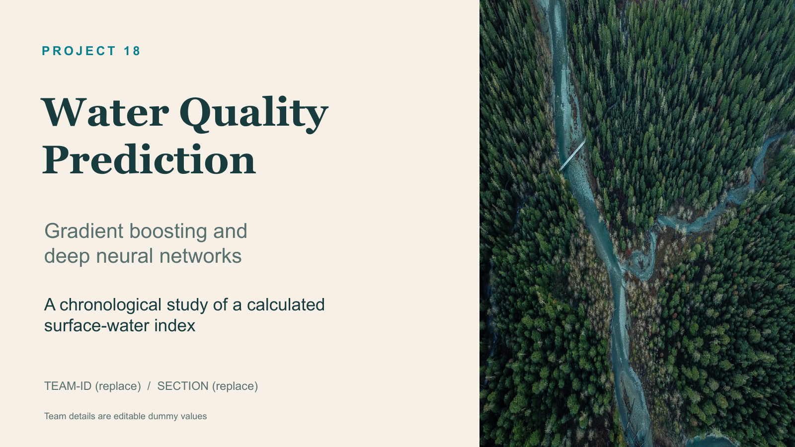

# Water Quality Prediction

**Project 18 · Gradient boosting and deep neural networks**

A reproducible comparison of **XGBoost** and a small **PyTorch MLP** on 2.83 million
surface-water records. Includes an interactive demo, executed notebooks, academic
PDF reports, an editable PowerPoint, saved models and a complete verification record.

[](https://github.com/hypnoastic/Water_Quality_Prediction/actions/workflows/verify.yml)

| Submission material | Open |
| --- | --- |
| Project report (10 pages) | [PDF](submission/Water_Quality_Project_Report.pdf) |
| Focused literature review (4 pages) | [PDF](submission/Water_Quality_Literature_Review.pdf) |
| Presentation (12 slides) | [PowerPoint](presentation/Water_Quality_Prediction.pptx) · [PDF](presentation/Water_Quality_Prediction.pdf) |
| Final verification and assignment fit | [Verification](submission/VERIFICATION.md) · [Assignment mapping](docs/ASSIGNMENT_ALIGNMENT.md) |
| Demonstration and viva | [Submission guide](docs/SUBMISSION_GUIDE.md) · [Viva notes](docs/VIVA.md) |
| Compact handoff | [Submission ZIP](submission/Water_Quality_Submission.zip), with code, saved models, reports and slides |

**Start here:** [Visual report](reports/report.html) · [Technical results](reports/report.md) ·
[Learning notes](learning.md) · [Data and target](docs/DATA.md)



## Delivered results

Evaluated on **202,886 chronological test rows** from 2021–2023:

| Model | MAE ↓ | RMSE ↓ | R² ↑ |
| --- | ---: | ---: | ---: |
| XGBoost | 0.1099 | 0.4262 | 0.99858 |
| MLP | 0.4466 | 0.9161 | 0.99345 |
| 90% XGBoost + 10% MLP | 0.1267 | 0.4222 | 0.99861 |

Validation selected the blend by RMSE; XGBoost has the lowest MAE. The blend's
nominal 90% intervals cover **89.3% overall**, but just **45.2% of Marginal rows**.
Read subgroup coverage before interpreting overall reliability. No statistical
significance is claimed for the small blend improvement. **16 tests pass**, including
saved-model parity, a working demo form and native-library compatibility.

## What are we predicting?

One continuous target: the published **`CCME_Values`**, on a 0–100 scale. Inputs are
ammonia, BOD, dissolved oxygen, orthophosphate, pH, temperature, nitrogen and nitrate.
The suggested turbidity, conductivity and dissolved-solids measurements are absent
from this dataset, so we do not invent them. No classification model is trained.

**The key finding:** the released target is a deterministic function of these same
eight inputs. The source formula reproduces every label within `1e-7`, including
its denominator of **12**. This is an **index-emulation benchmark**. It does not
demonstrate independent water-quality prediction, forecasting or drinking-water safety.
The source's row-level adaptation also differs from the
[official CCME site-period definition](https://ccme.ca/en/res/wqimanualen.pdf).
We retain the released target, document the differences and report the exact formula
as a diagnostic reference. See [the audit](docs/DATA.md).

## Run it

Python **3.12** is used for the delivered run. Run commands from this directory.
The original dataset is already present locally.

```bash
python3.12 -m venv .venv
source .venv/bin/activate
python -m pip install -r requirements.lock.txt
python -m pip install -e . --no-deps --no-build-isolation

# Launch the interactive local demo using the saved models
streamlit run app.py
```

The demo opens locally in a browser. Enter one sample or upload a CSV, choose a
trained model and download its predictions. No retraining or raw-data download is
needed to use the demo. Team details are intentionally dummy values, as requested.
Edit [submission/team.json](submission/team.json) when final identities are available.

For the CLI, use another terminal in the activated environment:

```bash
# Audit, train both families, evaluate, explain and regenerate every report
water-quality train --config configs/default.json

# Use the delivered saved model immediately
water-quality predict --input examples/measurements.csv

# Rebuild figures and prose from the completed run, without retraining
water-quality report

# Verification, including saved-model prediction parity
python -m pytest -q
ruff check src tests
python scripts/verify_submission.py
```

Alternatively, `python -m pip install -e '.[dev,demo,notebook,submission]'` installs
compatible dependencies without fixing the exact versions. `python -m water_quality`
also exposes the CLI.
Training is CPU based with four threads. The configuration caps the shared training
sample at 300,000 rows; **all** eligible calibration and test rows are evaluated.
Set `max_train_rows` to `0` to train on all historical rows, with higher runtime.
Change `output` and `artifacts` for experiments so the delivered run is preserved.
The lockfile uses PyTorch 2.9.1, XGBoost 3.1.2 and scikit-learn 1.7.2; this combination
was verified together on macOS after newer native runtimes conflicted.
For the walkthrough notebook, install `python -m pip install -e '.[notebook]'` if
you used the minimal dependency setup. The full lockfile includes notebook support.

All six original CSVs are included as **two compressed archives**, each below
GitHub's per-file limit. Run `python scripts/download_data.py` to restore and
hash-verify the combined CSV locally. If its archive is unavailable, the script
downloads the exact [Figshare v2](https://doi.org/10.6084/m9.figshare.27800394.v2) file.
Only that combined CSV is needed to train. See [data/README.md](data/README.md).

## Why these choices?

| Choice | Purpose |
| --- | --- |
| XGBoost, two tree depths | Strong tabular baseline; regularized boosted trees capture thresholds and interactions. |
| PyTorch MLP, two small architectures | Tests learned nonlinear combinations with dropout, weight decay and early stopping. |
| Mean and Ridge baselines | Show whether complexity improves on constant and additive predictions. |
| Validation-selected blend | Tests whether mixing tree and neural predictions helps; allows either family to win alone. |
| Train through 2018; validate 2019; calibrate 2020; test 2021–2023 | Prevents future observations from entering training or model selection. Sites can recur. |
| Train-only median imputation; eight quality flags | Handles invalid readings without deleting high-pollution extremes. |
| `asinh` then standard scaling for MLP/Ridge | Compresses skew while allowing legitimate negative temperatures. Trees use unscaled imputed readings. |
| MAE, RMSE and R² | Reports average error, large-error sensitivity and explained variance for the same continuous target. |
| Native TreeSHAP + validation permutation importance | Explains model reliance without a separate SHAP dependency; does not establish causality. |
| Held-out residual intervals | Measures uncertainty empirically; chronological shift means nominal coverage is not guaranteed. |

Candidate counts and shared training data are controlled. The small search is not
an exhaustive tuning competition. One seed is used; no significance claim is made.
The full protocol and per-country/per-index-band results are in the technical report.

## Repository map

```text
configs/default.json            Reproducible experiment settings
app.py                         Interactive Streamlit demo using the saved models
data/raw/combined/              Original combined CSV (training source)
data/raw/countries/             Original country CSVs (alternate views; never concatenate)
data/raw/*_source*.zip          All original CSVs, compressed for GitHub
data/reference/                 Original summary and source workbooks
notebooks/reference/            Original authors' notebooks, unchanged
notebooks/01_results.ipynb      Short walkthrough of the completed project
notebooks/02_eda.ipynb          Executed data exploration and target audit
notebooks/03_preprocessing.ipynb Executed chronological split and transform verification
notebooks/04_model_application.ipynb Executed comparison and saved-model inference
src/water_quality/
  data.py                      Schema, quality rules, formula audit, time split
  models.py                    Regularized MLP and training loop
  pipeline.py                  Shared experiment, selection, evaluation, explanations
  evaluation.py                Metrics and residual intervals
  predict.py                   Saved-model inference
  reporting.py                 Figures, Markdown and offline HTML report
  cli.py                       Audit / train / predict commands
tests/                         Leakage safeguards, boundaries and reload parity
scripts/download_data.py       Versioned download with SHA-256 verification
scripts/verify_submission.py   Final numerical and artifact verification
submission/                    Academic PDFs, dummy team metadata, verification
presentation/                  Editable PowerPoint, PDF, builder and native chart data
artifacts/                     Trained models, preprocessing and model metadata
reports/                       Measured results, manifests, seven figures and reports
examples/                      Small real-data inference fixtures
docs/DATA.md                   Provenance, target equation and source limitations
learning.md                    Short theory notes and lessons
requirements.lock.txt          Exact delivered environment
```

`reports/run_manifest.json` records the input SHA-256, versions, seed and effective
configuration. `reports/split_manifest.json` records dates, counts and site recurrence.
`reports/validation_candidates.csv` records every candidate and its training time.
`reports/predictions_test.csv.gz` retains all test predictions with original row IDs.
The example prediction command writes `reports/example_predictions.csv`; choose
`--model XGBoost`, `--model MLP` or `--model Blend` to compare saved models.
Prediction inputs must use the original column names and units shown in the example.

## Scope and next steps

The delivered data contain no missing cells but were already imputed upstream.
Some units and detection limits cannot be recovered. Future test coverage differs
by country; a time split does not demonstrate unseen-site generalization.
For a stronger scientific study, obtain independent outcomes or an official
site-window index with documented objectives, then assess genuinely future targets
or a prespecified reduced sensor panel. When all eight complete inputs are available,
the transparent formula is preferable for reproducing this exact source index.

## Attribution

Karim et al., *A Comprehensive Surface Water Quality Monitoring Dataset (1940–2023)*,
[Figshare, version 2](https://doi.org/10.6084/m9.figshare.27800394.v2), **CC BY 4.0**.
Original data, notebooks and workbooks are preserved; the new pipeline and analyses
are additions. See [data/README.md](data/README.md) and the report for references.

Submission organization takes inspiration from the user-supplied
[Flight_Delay_Prediction repository](https://github.com/abhi-7-7/Flight_Delay_Prediction).
The supplied [Canva deck](https://canva.link/jhwgwqkgeon4gbs) informed the presentation
structure. The code, measurements, findings and new deck belong to this water-quality
project. New code and analysis use the [MIT license](LICENSE); third-party data and
the credited presentation photograph retain their original licenses.
