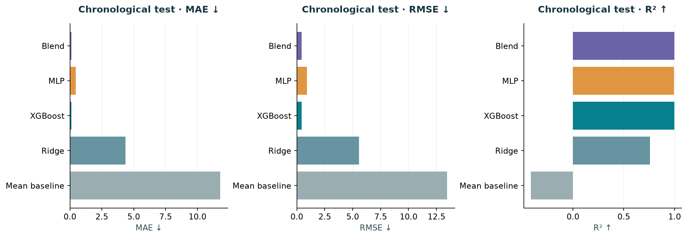

# Water Quality Prediction

**Project 18 · Water Quality Prediction via Gradient Boosting and Deep Neural Networks**

Compare XGBoost and a small PyTorch multilayer perceptron (MLP) for the continuous, 0–100 `CCME_Values` index. Three executed notebooks contain the complete process: data exploration, cleaning, chronological splitting, training, evaluation, explanations and prediction with saved models.

**Target interpretation:** the released index is calculated from the same eight measurements used as predictors. Our formula audit reconstructs every source label within `1e-7`. These results measure **index emulation**, not independent environmental outcomes or drinking-water safety. This source-defined, single-row calculation differs from official site-period CCME WQI.

## Repository structure

```text
Water_Quality_Prediction/
├── Datasets/
│   ├── Water_Quality_Dataset.zip
│   └── water_quality_project_outputs.zip
├── Notebooks/
│   ├── 01_eda.ipynb
│   ├── Preprocessing.ipynb
│   └── 02_Model_Application.ipynb
├── Reports/
│   ├── Water_Quality_Project_Report.pdf
│   ├── Water_Quality_Literature_Review.pdf
│   ├── Water_Quality_Prediction.pptx
│   └── Water_Quality_Prediction.pdf
├── figures/
├── .gitattributes
├── .gitignore
└── README.md
```

| Folder | What it contains and why |
|---|---|
| `Datasets/` | Original combined CSV in a ZIP, plus one ZIP of trained models and measured outputs. Compression keeps the source CSV below GitHub’s individual-file limit. |
| `Notebooks/` | All implementation and explanation in three notebooks. No external project modules or scripts are required. |
| `Reports/` | Final project report, focused literature review, editable PowerPoint and its PDF export. Team identities are intentionally dummy values. |
| `figures/` | Exported PNG charts: data overview, target/time coverage, correlations, temporal split, model comparison, predictions, feature importance, SHAP, learning curves and country performance. |

`.gitignore` excludes the local environment and regenerated intermediate files. `.gitattributes` tells Git to treat ZIPs, charts and documents as binary files.

## Run the project

Use **Python 3.12**. From the repository root:

```bash
python3.12 -m venv .venv
source .venv/bin/activate
python -m pip install numpy==2.3.4 pandas==2.3.3 scikit-learn==1.7.2 xgboost==3.1.2 torch==2.9.1 matplotlib==3.11.2 joblib==1.6.0 ipykernel notebook
python -m ipykernel install --user --name water-quality --display-name "Water Quality (Python 3.12)"
python -m notebook
```

On Windows, activate with `.venv\Scripts\activate`. In Jupyter, select the **Water Quality (Python 3.12)** kernel. Run every cell, in this order:

1. **[01_eda.ipynb](Notebooks/01_eda.ipynb)** — extract and verify the CSV, inspect units/missingness/duplicates, audit the target formula and export exploratory charts.
2. **[Preprocessing.ipynb](Notebooks/Preprocessing.ipynb)** — clean records, split by date, fit training-only transforms and save the local preparation cache.
3. **[02_Model_Application.ipynb](Notebooks/02_Model_Application.ipynb)** — train, tune, compare and explain models, calibrate residual intervals, export results and predict using reloaded weights.

The notebooks create `Datasets/_working/` for intermediate files. It is excluded from Git and can be deleted after use. CPU training uses four threads; allow several minutes and sufficient memory for the 2.8-million-row source.

**Are the models already trained? Yes.** To use them immediately, open the model notebook, set `RETRAIN = False` in section 2 and run its cells. This loads the included output ZIP and runs the saved-model example without needing the first two notebooks. Its final cell also shows how to predict your own CSV using the original headers and units.

**Verification:** all three notebooks were executed from a fresh copy. Every one of the 202,886 test predictions reproduced the recorded results. Saved-model loading and prediction were also checked.

## Data and target

[Karim et al., Figshare dataset, version 2](https://doi.org/10.6084/m9.figshare.27800394.v2): **2,827,977 rows**, 14 columns, five countries, 1940–2023. The original combined CSV is redistributed with attribution under **CC BY 4.0**. It was already harmonized and imputed by the data authors. Country-specific files are alternative views and are not appended to the combined file.

Inputs: ammonia, biochemical oxygen demand, dissolved oxygen, orthophosphate, pH, temperature, nitrogen and nitrate. Concentrations are labelled mg/L, pH is dimensionless and temperature is labelled °C. Turbidity, conductivity and dissolved solids are absent. Neither metadata nor the related `CCME_WQI` class is a predictor.

Source CSV SHA-256: `81ced159f465aa5ab004b77130e5f7147c698876ddbf2f97807e31c9d0e8d714`.

The EDA notebook implements and explains the released formula, including its upper-only objectives and inferred denominator of 12. See the [official CCME manual](https://ccme.ca/en/res/wqimanualen.pdf) for the different site-period standard.

## Models and fair comparison

| Method | Why it is included |
|---|---|
| Training-mean baseline | Checks whether learning improves on a constant prediction. |
| Ridge regression | Gives a simple regularized linear reference. |
| XGBoost | A strong tabular baseline for thresholds and interacting measurements. Depths 4/6, learning rate 0.05, up to 1,000 rounds and validation stopping. |
| PyTorch MLP | Tests learned nonlinear combinations. Hidden layers 64/32 or 128/64, ReLU, dropout 0.1, AdamW and at most 60 epochs. |
| Validation-selected blend | Tests whether mixing the two helps. Searches 21 weights; selected weight is 90% XGBoost and 10% MLP. |

Remove **9,971** exact duplicates. Flag invalid readings, fit median imputation on training only, and add eight quality flags. MLP and Ridge also use training-fitted `asinh` and standard scaling. Temperature outside [-5,50] °C is a review heuristic; unknown units are not guessed.

Training uses the same seed-42 sample of **300,000** pre-2019 records. Validation uses **2019** (50,000 rows for candidate tuning, all 87,177 for final selection). **2020** provides 49,182 calibration rows. Final testing uses all **202,886 records from 2021–2023**. Test results never select models.

## Results

| Model | Test MAE ↓ | Test RMSE ↓ | Test R² ↑ |
|---|---:|---:|---:|
| Mean baseline | 11.7909 | 13.4584 | -0.41409 |
| Ridge | 4.3442 | 5.5676 | 0.75799 |
| XGBoost | **0.1099** | 0.4262 | 0.99858 |
| MLP | 0.4466 | 0.9161 | 0.99345 |
| Blend | 0.1267 | **0.4222** | **0.99861** |

XGBoost is the strongest individual model. The blend slightly improves RMSE while worsening MAE. One seed does not establish statistical significance. The selected MLP reaches its epoch budget, so full convergence is unproven.



Permutation importance and native XGBoost TreeSHAP identify orthophosphate and ammonia as the dominant inputs. These directly enter the source formula; importance is not causality.

Nominal 90% residual intervals achieve **89.3%** overall coverage for the blend, but only **45.2%** on Marginal and **51.9%** on Poor index bands. Coverage is empirical under temporal shift. England dominates the dataset, 85.9% of test rows come from historical sites, China has no test rows and Canada has only 46. This is neither a future-target forecast nor a new-site benchmark. Computing the source formula is preferable when all original components are available.

The output ZIP contains `Models/` (weights, preprocessors, baselines and metadata) and `Results/` (full test predictions, metrics, subgroup scores, training histories, explanations, source audit, split details, versions and five prediction examples). All are generated by the model notebook. The report and presentation summarize these same measured results.

Repository organization follows the supplied [Flight Delay Prediction reference](https://github.com/abhi-7-7/Flight_Delay_Prediction). Presentation design draws on the supplied [Canva reference](https://canva.link/jhwgwqkgeon4gbs). Methods: [XGBoost](https://doi.org/10.1145/2939672.2939785), [Deep Learning, chapter 6](https://www.deeplearningbook.org/contents/mlp.html), [residual/conformal intervals](https://arxiv.org/abs/2107.07511).
