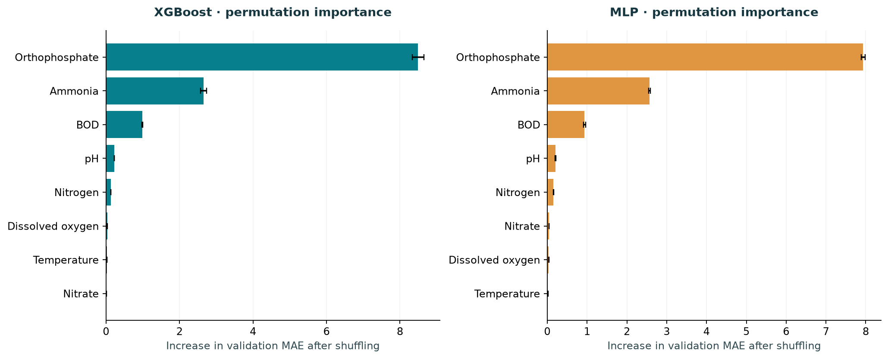
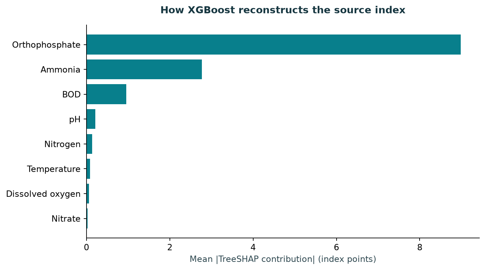

# Water quality prediction: XGBoost and neural networks

## Result

Blend was selected using validation RMSE. On 202,886 test rows, it achieved MAE 0.1267, RMSE 0.4222 and R² 0.99861. Its nominal 90% residual intervals covered 89.3% of test targets, with mean width 0.400 index points.

XGBoost has the lowest test MAE (0.1099). The blend changes test RMSE from 0.4262 to 0.4222, while its MAE is 0.1267. This is a small observed tradeoff, not evidence of a statistically significant improvement. Orthophosphate and ammonia dominate validation permutation importance in both models. Those measurements directly enter the source formula, so this ranking is not a causal finding.

**Interpretation:** The target is the dataset authors' derived row-level CCME_Values, not independently observed water quality. All eight target components are inputs. A deterministic formula reproduces 100.0% of all source labels within 1e-7 (maximum error 2.84e-14). High ML accuracy therefore measures formula emulation, not discovery of chemical mechanisms or safety.

## Data and target

2,827,977 source rows, 14 columns, five countries, 1940–2023. Eight inputs:
ammonia, BOD, dissolved oxygen, orthophosphate, pH, temperature, nitrogen and nitrate.
Concentrations use mg/L; pH is unitless
and temperature is labelled °C. Turbidity, conductivity and dissolved solids are absent.
Only continuous `CCME_Values` is predicted; `CCME_WQI` and all metadata are excluded from inputs.

The original harmonization notebook is preserved under `notebooks/reference/` because
it documents the derived target. See [data card](../docs/DATA.md) for the formula and audit.

## Protocol

Remove 9,971 exact duplicate rows. Keep pollution extremes. Flag negative concentrations, pH outside [0,14], nonfinite readings and temperature outside [-5,50] °C; the temperature bound is a conservative review rule, not a universal physical law. Replace flagged inputs with missing values and add eight quality flags. Fit median imputation on training only; MLP and Ridge additionally use asinh and standard scaling fitted on training. Split by date before fitting any transform. Use the same seeded uniform sample of 300,000 training rows for every model and 50,000 validation rows for candidate selection and early stopping. The full validation partition selects the model family and blend; 2020 data calibrate residual intervals; the complete 2021–2023 partition is evaluated after model selection. Neither calibration nor test rows are used for training.

| partition | rows | start | end |
| --- | --- | --- | --- |
| train | 2478761 | 1940-01-02 | 2018-12-28 |
| validation | 87177 | 2019-01-01 | 2019-12-31 |
| calibration | 49182 | 2020-01-01 | 2020-12-31 |
| test | 202886 | 2021-01-01 | 2023-12-17 |

These are available partition sizes; only the training and tuning samples are capped.
The exact configuration, data hash, versions and execution time are in `run_manifest.json`.
Historical sites may recur; split by time is not split by site. Labels still depend on same-row inputs.

## Model specification and validation search

All learned models receive eight measurements and eight missing/invalid flags.
XGBoost: histogram trees, learning rate 0.05, at most 1,000 rounds, depths 4/6,
minimum child weight 5, row subsampling 0.9, L2 penalty 5, 40-round early stopping.
MLP: 64→32 or 128→64 ReLU hidden layers, dropout 0.1, one linear regression output,
AdamW (learning rate 0.001, weight decay 0.0001), MSE on targets divided by 100,
batch size 2,048, at most 60 epochs and patience 10. Candidate checkpoints minimize
validation RMSE. Predictions are clipped to [0,100]. The selected MLP reached the
epoch budget; this does not establish full convergence. Ridge uses alpha 10 on the
same transformed inputs; the constant baseline predicts the training mean.

| family | architecture | mae | rmse | best_step | seconds |
| --- | --- | --- | --- | --- | --- |
| XGBoost | 4 | 0.1381 | 0.4781 | 999 | 2.3175 |
| XGBoost | 6 | 0.1198 | 0.4527 | 803 | 2.5170 |
| MLP | [64, 32] | 0.6412 | 1.1211 | 59 | 9.2482 |
| MLP | [128, 64] | 0.4690 | 0.9371 | 60 | 14.2529 |

Candidate scores use the sampled validation set; the final comparison below reports
full-validation RMSE. The blend searches 21 XGBoost weights from 0 to 1 by 0.05.

## Full chronological test results

| model | mae | rmse | r2 | coverage | mean_width | validation_rmse |
| --- | --- | --- | --- | --- | --- | --- |
| Mean baseline | 11.7909 | 13.4584 | -0.4141 | 0.9448 | 31.7458 | 13.4616 |
| Ridge | 4.3442 | 5.5676 | 0.7580 | 0.8423 | 13.9561 | 5.5677 |
| XGBoost | 0.1099 | 0.4262 | 0.9986 | 0.8840 | 0.3073 | 0.4520 |
| MLP | 0.4466 | 0.9161 | 0.9934 | 0.9034 | 2.2596 | 0.9376 |
| Blend | 0.1267 | 0.4222 | 0.9986 | 0.8933 | 0.4002 | 0.4469 |

MAE/RMSE are index points, lower is better. R² is relative to the test-target mean;
negative values are possible. Coverage and mean width describe nominal 90% intervals.
Blend weight on XGBoost: **0.90**, selected on validation.
The exact source formula is an audit reference, not a trained competitor: test MAE
1.177e-15.

## Selected-model subgroup results

| group | rows | mae | rmse | coverage |
| --- | --- | --- | --- | --- |
| Canada | 46 | 1.0060 | 1.8222 | 0.4783 |
| England | 147199 | 0.1509 | 0.4466 | 0.8689 |
| Ireland | 36230 | 0.0587 | 0.3056 | 0.9497 |
| USA | 19411 | 0.0685 | 0.4107 | 0.9742 |

| group | rows | mae | rmse | coverage |
| --- | --- | --- | --- | --- |
| Poor | 756 | 0.4934 | 0.7687 | 0.5185 |
| Marginal | 8033 | 0.4026 | 0.5961 | 0.4519 |
| Fair | 18266 | 0.2818 | 0.5569 | 0.6610 |
| Good | 82227 | 0.1606 | 0.5174 | 0.8962 |
| Excellent | 93604 | 0.0401 | 0.2356 | 0.9769 |

Index bands are descriptive slices of the released labels, not a separate classification task.
Group R² can be unstable for near-constant targets; consult raw subgroup CSV for full scores.

Overall interval coverage conceals substantial conditional undercoverage: the selected model covers only 45.2% of Marginal rows and 51.9% of Poor rows. A global residual radius is inadequate for uniform reliability across index bands. Canada has only 46 test observations and China has none; country conclusions are limited.

## Interpretation

Permutation importance measures the MAE increase when a measurement and its missing flag
are shuffled together on 2,000 validation rows, with three repeats.
Native TreeSHAP uses the selected boosting rounds and explains un-clipped tree outputs.
It includes missing-flag contributions separately in `shap_importance.csv`.

## Limitations

- The source adaptation checks all objectives as upper limits, including dissolved oxygen and pH, and divides scope/frequency/excursions by 12 although there are eight chemistry variables. It sets F2=F1 for one row. This differs from official site-period CCME WQI. The denominator is inferred from exact agreement with the delivered file; the notebook uses len(df.columns), so its result depends on the frame at execution time.

- The supplied data are already harmonized and imputed. Original missingness, censoring, detection limits and every unit conversion cannot be reconstructed. USA temperatures such as 63 under a Celsius header suggest unresolved unit questions; no Fahrenheit conversion is guessed. Quality flags cannot reverse upstream processing or repair targets.

- England contributes 75.3% of raw rows. Only countries actually present in the future test period have country scores. Their performance does not establish generalization to absent countries or new regions.

- This is a time-separated same-time-input benchmark, not a forecast: 85.9% of test rows have a Country+Area identifier seen in the historical training partition. Area is a coarse proxy; China has one unique Area. No claim of unseen-site generalization is made.

- The nominal 90% residual interval uses a finite-sample corrected calibration quantile. Temporal dependence and distribution shift violate exchangeability; coverage must be read empirically. It is a constant-radius interval, not learned chemical uncertainty, and has not been validated for artificially missing sensors.

- A bounded two-candidate search per learned family and one seed are reported. No statistical significance, exhaustive tuning or seed-stability claim is made. Permutation importance and SHAP explain predictions of a derived index; correlated inputs and upstream imputation prevent causal interpretation.

## Recommendation

Use the transparent source formula when the task is to reproduce this exact index from all eight complete inputs. XGBoost and the MLP are useful comparative learning experiments here. A meaningful next study needs independent outcomes or an official site-window index with documented local objectives, and withheld sensors or genuinely future measurements. Do not treat the released labels as a drinking-water decision.

## References

- [Dataset and attribution · Karim et al. · Figshare v2 · CC BY 4.0](https://doi.org/10.6084/m9.figshare.27800394.v2)
- [CCME WQI 2017 manual · official index definition](https://ccme.ca/en/res/wqimanualen.pdf)
- [XGBoost · Chen & Guestrin (2016)](https://doi.org/10.1145/2939672.2939785)
- [Deep Learning · Goodfellow, Bengio & Courville (2016), chapter 6](https://www.deeplearningbook.org/contents/mlp.html)
- [Conformal prediction · Angelopoulos & Bates (2021)](https://arxiv.org/abs/2107.07511)
